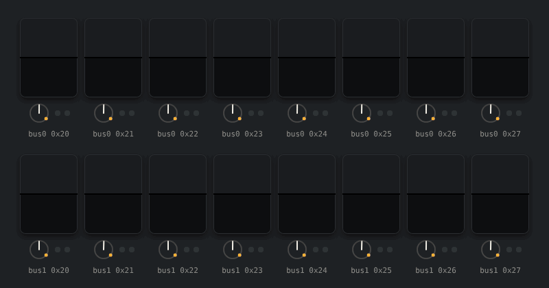

<p align="center">
  
</p>

<h1 align="center">Split-Flap-Emulator</h1>

<p align="center">
  <a href="https://github.com/DrewFerg11/Split-Flap-Emulator/tags"></a>
  <a href="https://github.com/DrewFerg11/Split-Flap-Emulator/actions/workflows/ci-test.yml"></a>
  <a href="https://github.com/DrewFerg11/Split-Flap-Emulator/actions/workflows/release.yml"></a>
  <a href="https://github.com/DrewFerg11/Split-Flap-Emulator/pkgs/container/split-flap-emulator"></a>
</p>

<p align="center">
  <a href="https://github.com/DrewFerg11/Split-Flap-Emulator/commits/main"></a>
  <a href="./LICENSE"></a>
  
  
  <a href="https://github.com/DrewFerg11/Split-Flap-Display"></a>
</p>

---

Run the real [Split-Flap Display](https://github.com/DrewFerg11/Split-Flap-Display) firmware without the hardware.
Virtual I²C modules, stepper motors, character drums and hall sensors stand in for the physical display, so
firmware can be tested automatically in CI or watched on a virtual display.

## Two ways to run it

The emulator has two modes. Both drive the same virtual hardware (PCF8575 expanders, steppers, drums and hall
sensors), use the same scenario files and produce the same reports.

| | **QEMU mode** (`--mode qemu`, default) | **Native mode** (`--mode native`) |
|---|---|---|
| Runs | The released firmware `.bin`, unchanged, on an emulated ESP32 ([lcgamboa QEMU fork](https://github.com/lcgamboa/qemu) with ESP32 I²C and Wi-Fi) | The firmware source, built for Linux against host shims of the Arduino/ESP32 APIs |
| Proves | The shipped artifact works | The code behaves correctly at any commit, branch or local checkout |
| Firmware input | `--firmware <factory.bin>` | `--firmware-src golden\|git:<ref>\|<checkout>`, or a prebuilt `--native-build` |
| Speed | About ⅓ of real time | Adjustable virtual clock, 0.25×–50× (default 5×) |
| Network | HTTP through loopback forwarding only | Real host sockets: HTTP, MQTT/Home Assistant and a controllable wall clock |
| Unique coverage | Byte-for-byte release check; wrong and prerelease versions are rejected | MQTT, time and DST scenarios, hours-long soaks in minutes, sanitizer builds |
| Build | Pinned QEMU fork, a few minutes once (cached) | Under a minute |
| Role | **Release gate:** strict, with no known-issues baseline (the firmware-side gate is not active yet, [#7](https://github.com/DrewFerg11/Split-Flap-Emulator/issues/7)) | **Fast feedback** and coverage QEMU cannot reach; never gates a release |

Use QEMU mode to decide whether a release is good, and native mode while developing firmware or for long and
network-heavy tests. Scenarios drive the firmware the way a user does (web UI, HTTP, MQTT) and check what the
virtual drums show. Most scenarios run in both modes; `*-native-*` scenarios are native only. CI runs the golden
v1.4.1 firmware through both on every push.

```sh
# QEMU mode: the released factory image
flapsim run --firmware firmware/splitflap-esp32_n4-v1.4.1-factory.bin --hardware esp32-8-single \
  --scenario scenarios/release-smoke-8.yaml --var FIRMWARE_VERSION=v1.4.1 --seed 7 \
  --known-issues baselines/v1.4.1-golden.yaml --out runs/qemu-8

# Native mode: build the golden source, then run the same scenario
flapsim run --mode native --firmware-src golden --hardware esp32-8-single \
  --scenario scenarios/release-smoke-8.yaml --var FIRMWARE_VERSION=v1.4.1 --seed 7 \
  --known-issues baselines/v1.4.1-native.yaml --out runs/native-8
```

v1.4.1 has known firmware defects, so golden runs use each mode's
[known-issues baseline](docs/scenarios.md#known-issue-baselines-golden-runs-only) (as CI does); without it they can fail
on those defects. New firmware releases run strictly, without `--known-issues`.

The container image `ghcr.io/drewferg11/split-flap-emulator` runs the same commands: `docker run <image> run ...`
is `flapsim run ...` ([container docs](docs/container.md)).

Details: [runner](docs/runner.md), [native mode](docs/native.md), [QEMU integration ADR](docs/adr/0001-qemu-integration.md),
[native mode ADR](docs/adr/0002-native-mode.md).

## Documentation

The full index is [`docs/README.md`](docs/README.md).

**Using flapsim**

- Stability and versioning: [`docs/stability.md`](docs/stability.md); release notes: [`CHANGELOG.md`](CHANGELOG.md)
- Running the emulator and writing scenarios: [`docs/runner.md`](docs/runner.md), [`docs/scenarios.md`](docs/scenarios.md)
- Physical hardware, configuration and state/timeline schemas: [`docs/hardware-model.md`](docs/hardware-model.md)
- Per-module physical calibration and firmware verification: [`docs/calibration.md`](docs/calibration.md)
- Container commands: [`docs/container.md`](docs/container.md)
- Native-mode checks in firmware CI: [`docs/firmware-ci.md`](docs/firmware-ci.md)
- Experimental in 1.0: authenticated state, runtime controls, I2C telemetry and declarative scenarios [`docs/control-api.md`](docs/control-api.md); read-only live display [`docs/panel.md`](docs/panel.md)

**Maintaining flapsim**

- Build, installation, checks and boot reproduction: [`docs/development.md`](docs/development.md)
- QEMU/firmware updates and publication: [`docs/maintenance.md`](docs/maintenance.md)
- Release gate for firmware: [`docs/release-gate.md`](docs/release-gate.md)
- Native internals, mechanics findings and decisions: [`docs/native.md`](docs/native.md), [`docs/mechanics-findings.md`](docs/mechanics-findings.md), [`docs/adr/`](docs/adr)
- History (implementation queue, POC findings, original MVP plan): [`docs/history/`](docs/history); POC code (removed, kept in git history): [`poc/` at e0bd421](https://github.com/DrewFerg11/Split-Flap-Emulator/tree/e0bd4215d8c3f7ad67b8e8568dad5e5a1ad671cf/poc)

## License

GPL-2.0, because the emulator builds on QEMU (GPLv2). Firmware run inside the emulator is not affected by this
licence.

QEMU source is pinned to [`e39508f79cb0681bbe15cfcebd40a3f45cdc3c48`](https://github.com/lcgamboa/qemu/tree/e39508f79cb0681bbe15cfcebd40a3f45cdc3c48).
The build applies no source patches; integration sources are in [`qemu/`](qemu).
