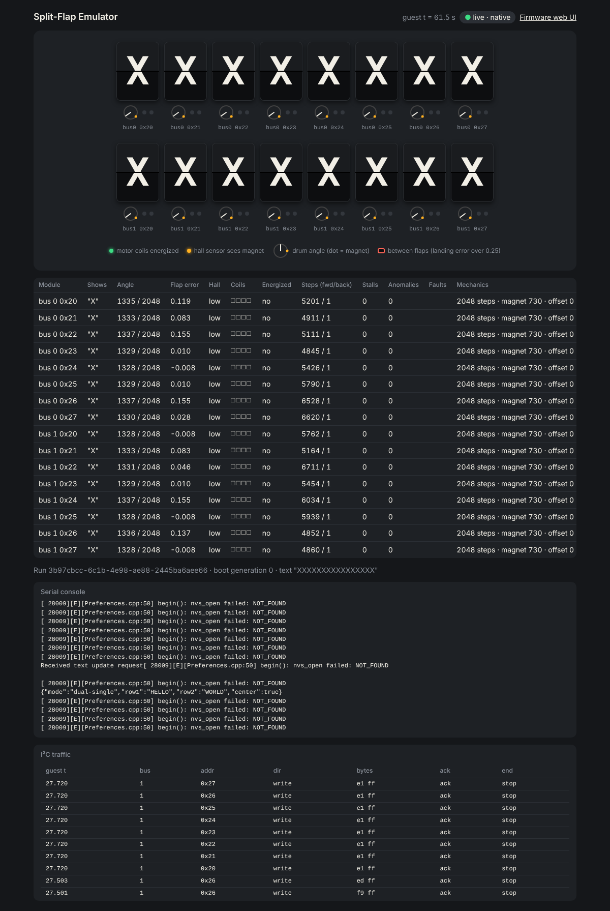

# Live display panel (issue #21, first slice)

> **Experimental in 1.0.** The live panel is shipped for early use and may change in 1.x releases while it is finished.

`flapsim panel` serves a read-only web page for a run started with `--control-port`.
It shows the virtual display and, for every module, what is physically showing,
its angle, flap error, hall level, coils, energized state, step counters, stalls and
anomalies. It refreshes four times a second, with a short flip when a flap changes.
Under each tile are the drum-angle dial (needle = drum, dot = magnet), a coil LED and a
hall LED. A tile outlined in red is between flaps: its landing error is over 0.25 of a flap
pitch.




```sh
# Terminal 1: a run with the control API enabled (QEMU or native)
flapsim run --mode native --native-build build/native/golden \
  --hardware esp32-16-dual --scenario release-smoke-16 \
  --var FIRMWARE_VERSION=v1.4.1 --control-port 0 --out runs/live

# Terminal 2: the panel for that run
flapsim panel --run runs/live --port 8765
# Panel for runs/live: http://127.0.0.1:8765/
```

## One look across the UIs

The live panel and the run's `replay.html` share one dark style and one display script
(`flapsim/data/ui/theme.css` and `display.js`, derived from the POC viewer). They are
inlined into each page when it is served or written, so both stay self-contained, with no
external assets and the panel's strict Content-Security-Policy unchanged. The replay adds
play/pause, a scrubber and a collapsible *Snapshot details* panel with the per-module table.
Its dials use the run's configured mechanics until a snapshot records a change.

## How it works

The [control API](control-api.md) needs a bearer token and rejects browser
origins, so the page cannot call it directly. The panel is a small loopback
server: it serves the page and fetches `GET /api/emu/state` itself, using the
`control.endpoint` and `control.token_file` the run records in `run.json`.

- **Read-only:** the panel only serves `/` and `/state`; it never forwards a
  mutation, and the token never reaches the browser.
- **Loopback only:** it binds `127.0.0.1` and rejects foreign `Host`/`Origin`
  headers, as the control API does. Its responses are `no-store`, with a strict
  Content-Security-Policy.
- **Follows the run:** it re-reads `run.json` on every request, so it can start
  before the run's control API is up. Until then, and after the run ends, `/state`
  answers 503 with the reason, and the page shows it.
- **No extra dependencies:** it uses the standard library HTTP server.

The panel and the run must share a loopback interface. In Docker, run both in the
same container, or use `--network host` on Linux.

## Not yet

These remaining #21 items wait on the control API's later slices (#20):

- what the firmware *should* be showing next to what is physically showing
- the I²C monitor and serial console
- fault, mechanics, power and reset controls
- loading firmware, a firmware web-UI link, and a long-running `serve` mode
