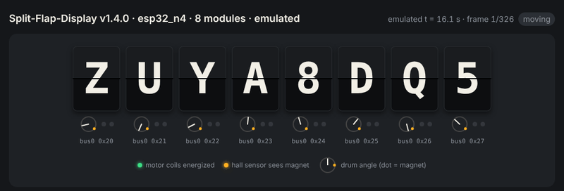
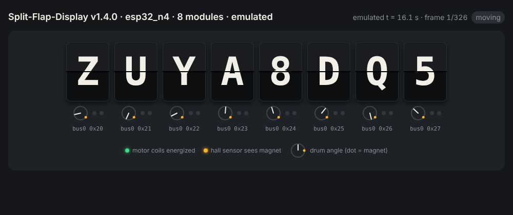
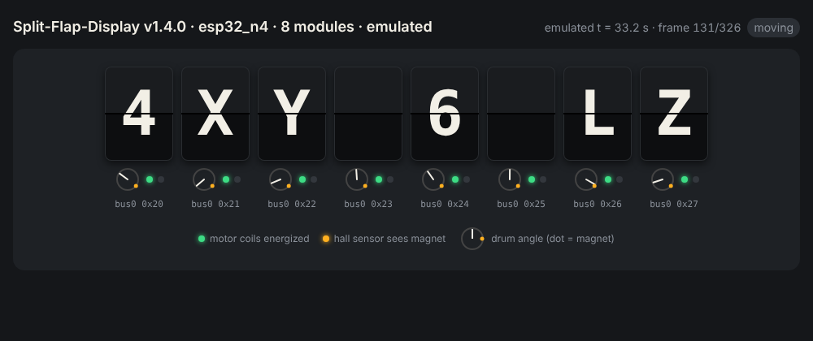
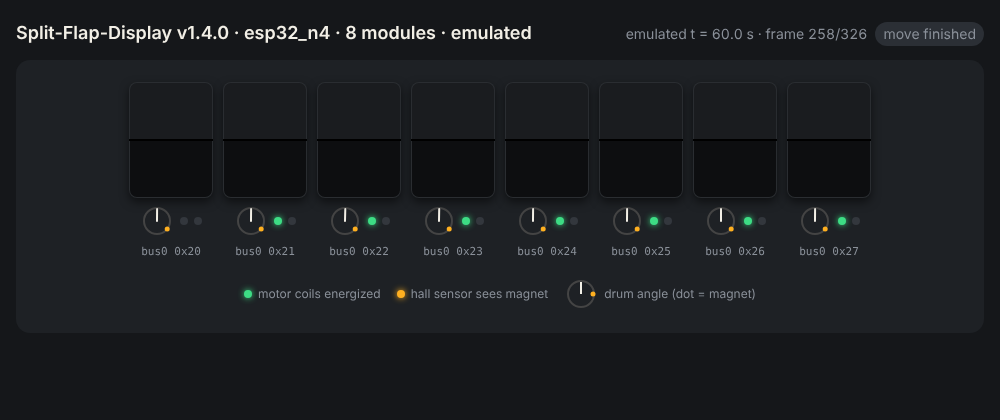
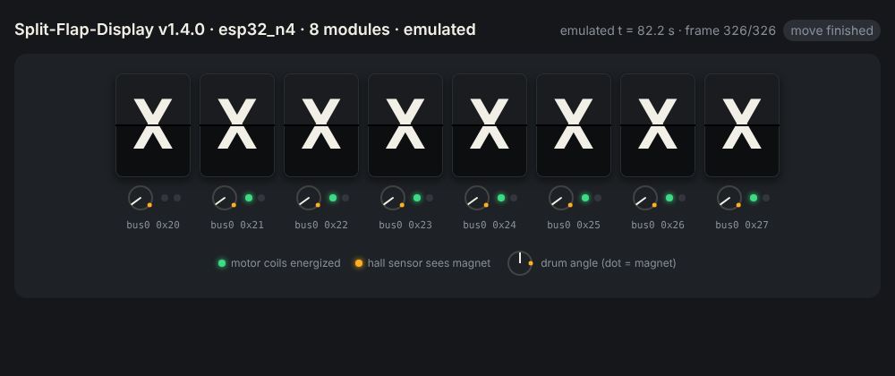

# Split-Flap-Emulator: POC findings and MVP implementation plan

**Status:** Proof of concept complete (October 2026). MVP phase 1 implementation and verification in progress.
**Audience:** whoever builds the MVP. This document is meant to be enough on its own.

## Contents

1. [Summary](#1-summary)
2. [Goals and non-goals](#2-goals-and-non-goals)
3. [The hardware contract we emulate](#3-the-hardware-contract-we-emulate)
4. [Platform research and decision](#4-platform-research-and-decision)
5. [What the POC built](#5-what-the-poc-built)
6. [POC results](#6-poc-results)
7. [Performance investigation](#7-performance-investigation)
8. [Firmware findings from the POC](#8-firmware-findings-from-the-poc)
9. [Lessons and pitfalls](#9-lessons-and-pitfalls)
10. [MVP architecture](#10-mvp-architecture)
11. [MVP scope](#11-mvp-scope)
12. [MVP implementation plan (step by step)](#12-mvp-implementation-plan-step-by-step)
13. [After the MVP](#13-after-the-mvp)
14. [Open questions](#14-open-questions)
15. [References](#15-references)

[MVP delivery progress and issue tracker](#mvp-delivery-progress)

---

## 1. Summary

The emulator runs the **real, unmodified release firmware** of
[Split-Flap-Display](https://github.com/DrewFerg11/Split-Flap-Display) on an emulated ESP32. Virtual hardware stands
in for the physical display: PCF8575 I/O expanders, 28BYJ-48 steppers, character drums and hall-effect sensors.

The POC proved the core idea with the published `v1.4.0` `esp32_n4` binary:

- the firmware boots, scans I²C and finds the virtual modules;
- it homes every drum from a random start position to the blank flap;
- it serves its real web UI to the host over emulated Wi-Fi;
- `POST /text` makes the virtual drums spell the text;
- settings persist across a reboot, and single-bus mode and dual-bus 16-module mode both work.

With `-icount shift=3`, motion timing matches real hardware (~500 steps/s against the firmware's 512 target), and
runs with the same seed and build are consistent. A boot-to-display run takes about 1.5–2 minutes of wall-clock time
on a 4-vCPU machine. That is fast enough to gate releases in GitHub Actions.

Using one binary, the POC found a real release bug (`v1.4.0` reports itself as `v1.4.0-rc.1`), plus several
firmware behaviours worth reviewing ([section 8](#8-firmware-findings-from-the-poc)).



## 2. Goals and non-goals

**Goals**
- Run release binaries, exactly as published, against virtual display hardware.
- Treat the firmware as a black box. The emulator knows the *hardware* (wiring, drums, sensors), never the firmware's
  settings or rules. Tests drive the firmware the way a user does: web UI, HTTP API, MQTT, serial.
- Gate releases in CI: block a release whose binary fails the scenarios.
- Produce human-readable evidence for each run: serial log, I²C/motor trace, and a visual replay of the drums.

**Non-goals**
- Electrical fidelity (power sag, I²C noise, RF), print quality and mechanical tolerances.
- Replacing the firmware repo's host unit tests. The two are complementary: unit tests check logic against fakes the
  firmware authors wrote, while the emulator checks the *shipped binary* (build flags, partitions, LittleFS assets,
  version injection, RTOS concurrency, boot/reboot/settings flows).
- Being a general-purpose ESP32 simulator.

## 3. The hardware contract we emulate

Taken from `Split-Flap-Display/src` at `v1.4.0`. This is the boundary the emulator implements.

**Per module: a PCF8575 16-bit I²C I/O expander**
- Addresses 0x20–0x27 by default (settings `wireAddresses`, `wire1Addresses`).
- Write: 2 bytes, low then high, with no register address. Read: 2 bytes, low then high.
- **P01–P04 (bits 1–4)** drive the stepper coils; a bit set to 1 means that coil is energized.
- **P17 (bit 15)** is the hall sensor input. The firmware treats bit 15 = 1 as "magnet detected"
  (`SplitFlapModule::readHallEffectSensor`).
- `stop()` writes `0xFFE1` (all coils off). The init state is `0xFFE1`.

**Coil sequence: full-step, two-phase**

| `stepNumber` | Value written | Coils on (bits 1–4) | Rotor phase |
|---|---|---|---|
| 0 | `0xFFE7` | P01+P02 | 0 |
| 1 | `0xFFF3` | P01+P04 | 1 |
| 2 | `0xFFF9` | P03+P04 | 2 |
| 3 | `0xFFED` | P02+P03 | 3 |

A phase change of +1 (mod 4) means one step forward. The firmware only ever steps forward.

**Drum and firmware defaults** (`SplitFlapDisplay.ino` settings)
- `stepsPerRot` = 2048, `magnetPosition` = 730, `maxVel` = 15 RPM (= 512 steps/s), `charset` = 37
  (`" ABCDEFGHIJKLMNOPQRSTUVWXYZ0123456789"`), 48 with the extended set.
- Character *i* is at step `(int)(i * stepsPerRot / charset)`.
- Homing: the firmware polls the hall sensor every 20 ms while stepping. On a rising detection it sets
  `position = magnetPosition + offset`.
- Any I²C error sets `hasErrored`, after which that module **never reads its hall sensor again**.

**Buses and builds**
- `esp32_n4` (ESP32 DevKit) is built with `ENABLE_DUAL_I2C`: Wire on SDA 21/SCL 22, Wire1 on SDA 33/SCL 32.
  Each bus moves on its own FreeRTOS task (`bus1Move` on core 1, `bus2Move` on core 0).
- Dual mode is used only if `wire1Addresses` is non-empty. Setting it to `""` gives single-bus mode at runtime.

**Release artefacts** (from `release.yml`)
- `splitflap-<env>-<tag>-factory.bin`: merged image (bootloader, partitions, boot_app0, app, LittleFS), 0x3F0000
  bytes long. It must be **padded with `0xFF` to exactly 4 MB** for QEMU.
- Flash mode DIO, 4 MB layout from `partitions_4MB.csv` (two 1.5 MB app slots, 896 KB LittleFS).

## 4. Platform research and decision

| Option | Runs real binary | I²C | Wi-Fi | Cost and licence | Verdict |
|---|---|---|---|---|---|
| Espressif QEMU fork | ✅ | ❌ not emulated | ❌ not emulated | Free | Not usable for this firmware |
| **lcgamboa QEMU fork** (`picsimlab-esp32`) | ✅ ESP32, C3 | ✅ callback hook per bus | ✅ open APs only, SLIRP NAT | Free, GPLv2 | **Chosen** |
| Velxio (wraps the lcgamboa fork) | ✅ | ✅ | ✅ | AGPLv3 / commercial | A good reference, but a whole IDE; we only need the engine |
| Wokwi | ✅ | ✅ custom chips API | ✅ | Free for personal/OSS use in the browser; CI is 50 min/month on the free tier, 5 min per run | Fallback if self-hosting fails |
| Renode | Partly (S3 is a work in progress) | ? | ? | Free | Not ready |
| Host-native build of the firmware | ❌ (not the shipped binary) | — | — | Free | Rejected: doesn't test what ships |

**Decision:** build on the lcgamboa QEMU fork, pinned to a known commit. The POC used
`e39508f79cb0681bbe15cfcebd40a3f45cdc3c48` (branch `picsimlab-esp32`, 2026-09-19).

Key facts about the fork, verified in the POC:
- Machine `esp32-picsimlab` (Xtensa). There is also a RISC-V `esp32c3-picsimlab` machine (untested). There is **no S3
  picsimlab machine**.
- Flash images of 2, 4, 8 or 16 MB are accepted.
- Each I²C controller has a `picsimlab_i2c` device that forwards every bus event (start, data byte, read request,
  finish) to the function pointer `picsimlab_i2c_event(id, addr, event)`. The return value ACKs or NACKs.
- There is a `tmp105` temperature sensor at 0x48 on bus 0. It's harmless, but it means address 0x48 is taken.
- The emulated Wi-Fi offers three **open** access points (`PICSimLabWifi`, `Espressif`, `MasseyWifi`), with no WPA2.
  Host networking uses QEMU user-mode networking (SLIRP): the guest network is `192.168.4.0/24` and the host is
  `192.168.4.2`.
- The fork can be built as a shared library (`build_libqemu-esp32.sh`) and exposes
  `qemu_picsimlab_register_callbacks()`. That makes it possible to use the fork **unmodified** (see Step 2).
- QEMU is GPLv2, so this repository is GPLv2. The firmware under test is unaffected, because it is only input data.

## 5. What the POC built

All POC code is in [`poc/`](../poc); see [`poc/README.md`](../poc/README.md) for how to reproduce.

| File | Purpose |
|---|---|
| `qemu-lcgamboa.patch` | Two-line change: include the model and point `picsimlab_i2c_event` at it |
| `flapsim_model.c` | Hardware model (≈300 lines): PCF8575 + stepper + drum + hall sensor per address, with diagnostics |
| `experiment.sh` | Boot a release image under a given configuration; logs go to `runs/<name>/` |
| `analyze.py` | Summarise a run: moves, step rate, wall vs emulated time, errors |
| `net_scenario.py` | End-to-end: AP mode → `POST /settings` → reboot → `POST /text` → check drums; MQTT receive check (local Mosquitto) |
| `viewer_template.html`, `render.py`, `shot.js` | Timeline → standalone HTML replay → PNG screenshots → GIF |

The model is configured through environment variables (`FLAPSIM_BUS0/1`, `FLAPSIM_STEPS`, `FLAPSIM_MAGNET`,
`FLAPSIM_WINDOW`, `FLAPSIM_SEED`, `FLAPSIM_TRACE`, `FLAPSIM_STATE`, `FLAPSIM_TIMELINE`, `FLAPSIM_LOG_HALL`). The MVP
replaces these with a hardware config file.

## 6. POC results

| Capability | Result |
|---|---|
| Boot the real release binary | ✅ Banner, chip info, LittleFS web UI |
| I²C scan | ✅ Configured addresses ACK; missing ones NACK and the firmware reports `MISSING` (error code 2) |
| Homing from random angles | ✅ Every drum lands on blank (within ~10 steps, which is the firmware's 20 ms polling granularity) |
| 8 modules, single bus (`wire1Addresses=""`) | ✅ No-Wi-Fi display shows `WIFI ERR` (the correct 8-module message) |
| 16 modules, dual bus | ✅ Both rows home; no-Wi-Fi display `[XXXXXXXX] [XXXXXXXX]`; no I²C errors |
| Accurate motion timing | ✅ `-icount shift=3`: 500 steps/s (target 512); consistent across runs with the same seed and build (not bit-for-bit) |
| Host → firmware HTTP | ✅ `GET /version`, `GET /settings`, `GET /index.html`, `POST /settings`, `POST /text` |
| Web control → drums | ✅ `POST /text {"mode":"single","words":["HELLO"],"center":true}` → `[ HELLO  ]` in ~6 s |
| Settings persistence + reboot | ✅ A hardware-setting change triggers a reboot; settings survive in emulated flash |
| MQTT outbound | ✅ Connects to host Mosquitto; publishes availability and Home Assistant discovery |
| MQTT inbound → drums | ❌ Needs station mode (see Wi-Fi below and finding 3) |
| Station-mode Wi-Fi | ❌ Emulated APs are open; the firmware requires a password, and with one set the ESP32 stack requires WPA2 |
| Visual replay | ✅ HTML replay, PNGs and GIF |

| Start (random drums) | Homing | Homed | No-Wi-Fi "X" |
|---|---|---|---|
|  |  |  |  |

## 7. Performance investigation

**Symptom:** in the default (real-time) mode, drums stepped at ~270 steps/s instead of 512, and homing took ~45 s.

**Root cause:** TCG (QEMU's CPU emulator) runs the guest at roughly half real ESP32 speed on this host, and the
firmware's stepping loop is CPU-bound. It busy-waits on `micros()` and does I²C work between steps, so under
wall-clock time it steps late. Two things were ruled out:
- **I²C:** the emulated I²C controller is instantaneous; no bus time is modelled.
- **Core scheduling:** multi-threaded TCG did not help.

**Fix:** `-icount shift=N` makes guest time advance per instruction instead of following the wall clock, so the
firmware sees a CPU of fixed speed.

Measurements: 8 modules, same seed, one emulated board per host core, 4-vCPU cloud container:

| Mode | Step rate (target 512) | Speed vs real time | Boot → final display (wall) |
|---|---|---|---|
| Real-time (default) | 262–291 ❌ | 1.0× | ~70 s, wrong timing |
| MTTCG `-accel tcg,thread=multi` | 287–291 ❌ | 1.0× | no help |
| `-icount shift=2,sleep=off` (~250 MIPS) | 500 ✅ | 0.20× | ~119 s |
| **`-icount shift=3,sleep=off`** (~125 MIPS) | **500 ✅** | **0.33×** | **~87 s** |
| `-icount shift=4,sleep=off` (~62 MIPS) | 460 ⚠️ | 0.53× | ~66 s |

- `sleep=off` means idle periods cost no wall-clock time; guest time jumps ahead.
- Two `shift=2` runs with the same seed finished their moves within 0.06 s of each other. That is consistent enough
  for repeatable tests, but not bit-for-bit deterministic, so scenarios should assert on settled states, not exact
  timestamps.
- **Recommendation:** `shift=3` for CI, `shift=2` for timing-sensitive checks, real-time mode only for watching it
  live.
- MTTCG and `-icount` cannot be combined.

## 8. Firmware findings from the POC

These were found by running the `v1.4.0` binary. Items marked *confirm* should be checked on real hardware before
acting on them.

1. **Bug: the stable release reports an RC version.** `v1.4.0` prints `Firmware: v1.4.0-rc.1` and `GET /version`
   returns `v1.4.0-rc.1`. Tags `v1.4.0` and `v1.4.0-rc.1` point at the same commit, and
   `build/scripts/inject_version.py` uses `git describe --tags`. A fix task was raised in the firmware repo.
2. **Open Wi-Fi networks are unsupported.** `SplitFlapWebServer::loadWiFiCredentials()` requires
   `ssid != "" && password != ""`.
3. **MQTT is half-wired in AP mode.** A settings change can connect MQTT while in AP mode, but
   `splitflapMqtt.setDisplay()` is only called in the station-mode branch of `setup()`, so incoming messages are
   logged (`[MQTT] Message received`) and then dropped.
4. **Homing spins each drum about two full turns** (*confirm*). Phase 1 targets `position - 1`, and blank (step 0) is
   then almost another full turn away. That costs ~4 s per homing.
5. **On `esp32_n4`, 8-module displays wait on 8 missing modules** (*confirm*). The default `wire1Addresses` lists 8
   addresses, so each move waits for the bus-2 task to step missing modules blindly. `wire1Addresses=""` avoids it.
   Consider changing the default or the docs.
6. **Bus 2 finishes ~3.5 s after bus 1** (*confirm*). Its task runs on core 0 alongside Wi-Fi.

## 9. Lessons and pitfalls

- **Define "settled" carefully.** The POC first reported a "row 2 lands on wrong letters" bug. That was the
  emulator's own snapshot firing when the *first* module released its coils while row 2 was still moving. "Move
  finished" must mean **all** modules de-energized, ideally plus a short quiet period.
- **Wait for the right serial markers.** `AP IP Address` is printed again on MQTT reconnects, not only at boot; use
  `Reset reason: software reset` to detect reboots. `AP IP Address` also contains the substring `IP Address`, so
  anchor regexes (`(?m)^IP Address`).
- **The firmware is busy during startup.** HTTP requests sent during homing can take more than 20 s to be answered
  under emulation. Wait for the startup display (`XXXXXXXX` / `WIFI ERR`) before driving it.
- **Host ports.** A leftover QEMU holding `hostfwd` ports makes the next one fail with "Could not set up host
  forwarding rule". Use per-run ports.
- **Don't `pkill -f` a pattern** that appears in your own command line.
- **A model reset is not a firmware reset.** The model's drum state survives a guest reboot, which is realistic:
  drums don't move when the ESP32 resets.
- The firmware's `hasErrored` latch means one transient I²C error permanently disables homing for that module. Fault
  injection tests should expect that.

## 10. MVP architecture

```
                         ┌───────────────────────────── flapsim (Docker image) ─────────────────────────────┐
  release .bin  ───────► │  runner CLI (Python)                                                             │
  hardware.yaml ───────► │   ├─ prepares flash (pad to 4 MB, fresh copy per run)                             │
  scenario.yaml ───────► │   ├─ starts QEMU (lcgamboa fork, pinned) with -icount shift=3, SLIRP + hostfwd    │
                         │   │     └─ flapsim hardware model ◄── I²C events (picsimlab_i2c_event)            │
                         │   │           writes state.json + timeline.jsonl                                  │
                         │   ├─ runs scenario steps: serial waits, HTTP, MQTT (bundled Mosquitto), asserts   │
                         │   └─ writes artefacts: report.md, junit.xml, serial.log, timeline, replay.html    │
                         └──────────────────────────────────────────────────────────────────────────────────┘
```

- **One emulated board per QEMU process** (QEMU uses global state). Run boards in parallel as separate processes.
- **Model placement:** prefer *unmodified QEMU as a shared library* with the model registered through
  `qemu_picsimlab_register_callbacks()` (route B). Fall back to the POC's *pinned commit + small patch* (route A).
  Decided in Step 2.
- **State interface:** the model writes `state.json` (latest settled state) and `timeline.jsonl` (snapshots and
  events). The runner only reads files, which keeps the model simple and the runner testable.

Proposed repository layout:

```
split-flap-emulator/
├── README.md
├── LICENSE                     # GPLv2
├── docs/                       # this document, usage docs, images
├── poc/                        # frozen POC (reference only)
├── qemu/
│   ├── QEMU_COMMIT             # pinned lcgamboa commit
│   ├── build.sh                # fetch + (patch) + build
│   └── patches/                # route A only
├── model/                      # C hardware model (+ unit tests)
├── flapsim/                    # Python package: CLI, runner, scenarios, report, viewer
│   └── viewer/                 # replay HTML template
├── hardware/                   # example hardware configs (8-single, 16-dual)
├── scenarios/                  # built-in scenarios (release-smoke.yaml, ...)
├── tests/                      # Python tests for runner/scenarios
├── Dockerfile
└── .github/workflows/          # ci.yml (lint/test/build image), publish.yml (GHCR)
```

## 11. MVP scope

**In:** ESP32 (`esp32_n4`) only; 8-module single-bus and 16-module dual-bus hardware configs; AP-mode networking
(web UI and HTTP API); the release smoke scenario; consistent timing (`shift=3`); CI artefacts with replay; Docker
image; a `sim-test` job in the firmware repo's `release.yml`.

**Out (post-MVP):** station-mode Wi-Fi / WPA2 (and so MQTT inbound, NTP time modes, network OTA); ESP32-C3 and S3;
Improv serial provisioning; fault injection; I²C bus timing; the home-lab live display; soak tests.

**MVP done when:** a release tag in Split-Flap-Display triggers a job that boots each release `esp32_n4` image under
the emulator, runs the smoke scenario on both hardware configs, attaches a report and replay, and blocks publishing
on failure, all within ~15 minutes.

## MVP delivery progress

The original steps below are grouped into six implementation issues. Execute the phases in order; tests and
GitHub Actions checks land with each phase, starting in phase 1. The original step numbers remain stable for
technical references. Golden regression checks from step 11 are introduced incrementally in phases 1–4;
maintenance documentation is completed in phase 5.

Phase 1 is **in progress** on `mvp/02-foundation`; later phases are queued. No phase is complete until its
implementation is merged and acceptance passes. See the [ordered PR queue](implementation-queue.md) and
[phase-1 reproduction instructions](development.md).

| Phase | Tracking issue | Original steps | Status |
|---|---|---|---|
| 1 | [Project foundation, pinned QEMU integration, and initial CI](https://github.com/DrewFerg11/Split-Flap-Emulator/issues/2) | 0–2; initial regression checks from 11 | In progress: build, callback launcher and real-boot verification; [ADR](adr/0001-qemu-integration.md) |
| 2 | [Production hardware model and configuration](https://github.com/DrewFerg11/Split-Flap-Emulator/issues/3) | 3–4 | Not started |
| 3 | [Isolated runner and process supervision](https://github.com/DrewFerg11/Split-Flap-Emulator/issues/4) | 5 | Not started |
| 4 | [Scenarios, smoke tests, reports, and replay](https://github.com/DrewFerg11/Split-Flap-Emulator/issues/5) | 6–8; golden regression checks from 11 | Not started |
| 5 | [Docker packaging, verified publishing, and maintenance](https://github.com/DrewFerg11/Split-Flap-Emulator/issues/6) | 9; maintenance from 11 | Not started |
| 6 | [Firmware release gating](https://github.com/DrewFerg11/Split-Flap-Emulator/issues/7) | 10; companion firmware-repository PR | Not started |

[View all MVP issues](https://github.com/DrewFerg11/Split-Flap-Emulator/issues?q=is%3Aissue%20label%3Amvp).
Each issue uses the `[MVP n/6]` title prefix and `mvp` label, with implementation checklists, dependencies,
tests/workflow requirements, acceptance criteria, and scope boundaries.

**Keeping this plan current**
- Use issue checkboxes and comments for working notes and current blockers.
- In each implementation PR, update this table's status and link the implementation PR and verification evidence.
  If a phase needs multiple PRs, keep it in progress until all acceptance criteria are met and merged.
- Record material architecture decisions, changed interfaces, scope changes, and justified acceptance deviations
  next to the affected original step (and in an ADR when appropriate). Preserve the historical POC findings.
- Mark a phase complete only after the implementation is merged and its required checks pass. A created issue,
  open PR, or local-only demonstration does not establish completion.
- Keep the top-level status and README consistent with delivered functionality. Declare the MVP complete only
  after the companion firmware release gate is operational and verified as required by section 11.
- Preserve `poc/` as frozen reference; production behavior and new documentation belong outside that directory.

## 12. MVP implementation plan (step by step)

Each step lists **tasks**, the **deliverable**, and **acceptance criteria**. Follow the dependency order in the
six-phase tracker above. Each phase is a reviewable implementation chunk; the original steps remain its technical
checklist. Tests and CI evolve within each phase rather than waiting until step 11.

### Step 0: Repository skeleton
**Tasks**
- Add `README.md` (what it is, status, link to this doc), `.gitignore` (`runs/`, `build/`, `*.bin`, `__pycache__/`),
  `.editorconfig`.
- Create the layout from [section 10](#10-mvp-architecture) with placeholder READMEs.
- Add a Python project (`pyproject.toml`, package `flapsim`, Python ≥ 3.11) with `ruff` and `pytest`.
- CI workflow `ci.yml`: ruff, pytest, `clang-format --dry-run` on `model/`.

**Acceptance:** CI is green on an empty test suite; `pip install -e .` provides a `flapsim --help` entry point.

### Step 1: Pinned QEMU build
**Tasks**
- `qemu/QEMU_COMMIT` = `e39508f79cb0681bbe15cfcebd40a3f45cdc3c48`.
- `qemu/build.sh`: shallow-fetch that commit from `https://github.com/lcgamboa/qemu`, then configure with:
  `--target-list=xtensa-softmmu --extra-cflags=-fPIC --enable-tcg --enable-system --disable-werror --enable-gcrypt --enable-slirp`
  plus `--disable-<everything else>`. Copy the flag generation from the fork's `build_libqemu-esp32.sh`.
  **`-fPIC` is required**; without it the link fails with "relocation R_X86_64_32 … recompile with -fPIE".
- Build dependencies (Debian/Ubuntu): `ninja-build libglib2.0-dev libgcrypt20-dev libslirp-dev libpixman-1-dev
  python3-venv flex bison pkg-config`.
- Build `qemu-system-xtensa` and copy `pc-bios/esp32-v3-rom*.bin` next to it.

**Acceptance:** `qemu-system-xtensa -M esp32-picsimlab -L <bios> -drive file=<padded v1.4.0 image>,if=mtd,format=raw
-nographic -serial stdio` prints `=== Split Flap Display ===`. The build takes ≤ ~10 min on a 4-vCPU machine.

### Step 2: Spike: unmodified QEMU (route B) vs patch (route A). Timebox 1–2 days
**Implementation note (phase 1):** the pinned callback ABI and upstream shared-library link recipe support a
single C launcher integration (route B). The launcher keeps initialization, main loop and cleanup on its original
thread. See [ADR 0001](adr/0001-qemu-integration.md) for the spike evidence and phase-3 executable contract;
the historical tasks below remain the original decision checklist.

**Tasks**
- Build the shared library with the fork's own `build_libqemu-esp32.sh` (it produces `libqemu-xtensa.so`).
- Write a minimal C host program that `dlopen`s the library, registers a `callbacks_t` whose `picsimlab_i2c_event`
  ACKs 0x20 and logs events, then starts QEMU through the library entry points. Use PICSimLab's or Velxio's
  integration as the reference for `qemu_init`/`qemu_main_loop`, which must run on the same thread.
- If it works: route B, and the model lives in `model/` and is linked into this host program.
- If not: route A, with `qemu/patches/0001-flapsim-i2c-hook.patch` from `poc/qemu-lcgamboa.patch`. Copy the model
  source into `hw/xtensa/` at build time and include it from there.

**Deliverable:** `docs/adr/0001-qemu-integration.md` recording the decision and why.
**Acceptance:** the v1.4.0 image boots and its module scan reports 0x20 found through the chosen route.

### Step 3: Hardware model (production version of `flapsim_model.c`)
**Tasks**
- Port the POC model into `model/`, split into `pcf8575.c`, `stepper.c`, `drum.c` and `bus.c`.
- Behaviour to keep, all verified in the POC:
  - ACK only configured addresses, NACK others;
  - apply a write on `FINISH` when exactly 2 bytes were written;
  - reads return the latch with bit 15 = hall;
  - stepping is a phase-delta model (+1 forward, −1 back, ±2 stall counter);
  - de-energizing loses the phase, and the next energize snaps without moving;
  - the displayed flap is the *nearest* flap: `round(angle * N / steps) mod N`.
- Add per-module counters (forward, back, stalls, writes, reads) and anomaly detection (START while open; FINISH
  with 1 or 3+ bytes).
- **Settled detection:** emit `move_finished` only when *all* present modules are de-energized.
- Outputs: `state.json` (rewritten on settle), `timeline.jsonl` (snapshot every 100 ms of guest time while any coil
  is energized, plus events), and an optional verbose I²C trace.
- Unit tests for the model in C (or through a tiny Python ctypes harness): coil sequence → steps, hall window, flap
  rounding, NACK for absent addresses.

**Acceptance:** model unit tests pass. Booting v1.4.0 with 8 modules gives a final settled state of `XXXXXXXX` with
zero stalls and zero anomalies.

### Step 4: Hardware config file
**Tasks**
- Define `hardware/*.yaml` and load it in the runner, which passes it to the model as a JSON file path in one env var
  or argument:
  ```yaml
  chip: esp32                     # MVP: esp32 only
  buses:
    - id: 0                       # I2C controller 0 = firmware "Wire"
      modules: [0x20, 0x21, 0x22, 0x23, 0x24, 0x25, 0x26, 0x27]
    - id: 1                       # I2C controller 1 = "Wire1"; empty list = no second row
      modules: []
  drum:
    steps_per_rotation: 2048
    flaps: " ABCDEFGHIJKLMNOPQRSTUVWXYZ0123456789"
    magnet_position: 730          # physical step where the sensor sees the magnet
    sensor_window: 40             # steps the sensor stays active
  start_angles: random            # or a list, or a seed: {seed: 7}
  ```
- Ship `hardware/esp32-8-single.yaml` and `hardware/esp32-16-dual.yaml`.

**Acceptance:** both configs load; invalid configs give clear errors (pytest).

### Step 5: Runner CLI
**Tasks**
- `flapsim run --firmware <factory.bin> --hardware <yaml> --scenario <yaml> --out <dir> [--timing ci|accurate|realtime]`.
- Flash prep: copy the image, check its size is ≤ 4 MB, pad with `0xFF` to exactly 4 MB, and never modify the input.
- Pick free host ports per run and pass
  `-nic user,model=esp32_wifi,net=192.168.4.0/24,hostfwd=tcp::<port>-192.168.4.1:80`.
- Timing modes: `ci` = `-icount shift=3,sleep=off` (default), `accurate` = `shift=2,sleep=off`, `realtime` = no
  icount.
- Always pass `-global driver=timer.esp32.timg,property=wdt_disable,value=true`, `-nographic`, `-monitor none`, and
  `-serial file:<out>/serial.log`. Add a serial input channel later for Improv.
- Process supervision: a hard wall-clock timeout per scenario, then kill QEMU on exit, Ctrl-C or failure (no orphans).
- Exit code 0 means pass and non-zero means fail.

**Acceptance:** `flapsim run` with a no-op scenario boots, writes `serial.log`, `state.json` and `timeline.jsonl`,
and exits cleanly. Running it twice in parallel works.

### Step 6: Scenario engine
**Tasks**
- YAML scenarios made of steps with timeouts (wall-clock seconds):
  ```yaml
  name: release-smoke
  steps:
    - wait_serial: "=== Split Flap Display ==="
    - expect_serial: "Firmware: ${FIRMWARE_VERSION} "     # version must match the tag
    - wait_serial: "AP IP Address"
    - wait_display: "XXXXXXXX"                            # settled; 8-module dual default shows X
    - http: {method: GET, path: /version, expect_json: {version: "${FIRMWARE_VERSION}"}}
    - http: {method: POST, path: /settings, json: {wire1Addresses: "", wire1Offsets: ""}}
    - wait_serial: "Reset reason: software reset"
    - wait_display: "WIFI ERR"
    - http: {method: POST, path: /text, json: {mode: single, words: [HELLO], center: true}}
    - wait_display: " HELLO  "
  ```
- Step types for the MVP: `wait_serial`, `expect_serial` (search so far), `wait_display` (exact match on the
  *settled* state; `.` wildcard per module), `http`, `sleep_guest` (optional), `assert_no_errors` (no stalls or
  anomalies; optional allow-list of serial errors).
- Variables come from the CLI (`--var FIRMWARE_VERSION=v1.4.0`).

**Acceptance:** pytest covers each step type against a fake QEMU, using recorded `serial.log` and `state.json`
fixtures from the POC. The release-smoke scenario passes on v1.4.0 *except* the version assertion, which fails
because of finding 1. That failure proves the gate works.

### Step 7: Built-in scenarios
**Tasks**
- `scenarios/release-smoke-8.yaml`: the scenario above (8 modules, switches to single bus).
- `scenarios/release-smoke-16.yaml`: 16-module dual; `wait_display: "XXXXXXXXXXXXXXXX"`; `POST /text` with mode
  `single` and the dual-row expectations (check the firmware's dual modes for the exact JSON).
- `scenarios/homing-random.yaml`: 3 different seeds; expect blank after homing with zero stalls.

**Acceptance:** all three pass against v1.4.0 (with the version check skipped through a variable) in ≤ 5 min wall
each with `--timing ci`.

### Step 8: Reports and replay
**Tasks**
- `report.md` (pass/fail per step, timings, display snapshots as text, counters) and `junit.xml`.
- `replay.html`: port `poc/viewer_template.html` and `poc/render.py`. Self-contained, with play/scrub controls.
- When `GITHUB_STEP_SUMMARY` is set, append `report.md` to it.
- Optional: a GIF through headless Chromium + ffmpeg (`poc/shot.js`). Keep it optional, because it costs time.

**Acceptance:** a failed run produces a report showing which step failed, the expected vs actual display, and the
last 50 serial lines.

### Step 9: Docker image
**Tasks**
- Multi-stage `Dockerfile`: stage 1 builds QEMU and the model; stage 2 is `debian:bookworm-slim` + Python + runtime
  libs (`libglib2.0-0 libgcrypt20 libslirp0 libpixman-1-0`) + Mosquitto (for post-MVP MQTT) + the `flapsim`
  package + hardware configs + scenarios.
- `ENTRYPOINT ["flapsim"]`.
- `publish.yml`: build and push `ghcr.io/drewferg11/flapsim:<version>` and `:latest` on tags, with layer caching.
- README: the exact QEMU commit and source link (GPL source availability).

**Acceptance:**
`docker run --rm -v $PWD:/work ghcr.io/drewferg11/flapsim run --firmware /work/fw.bin --hardware esp32-8-single
--scenario release-smoke-8 --out /work/out` passes on a clean machine.

### Step 10: Integration into Split-Flap-Display releases
**Tasks** (a PR in the firmware repo)
- New job `sim-test` in `.github/workflows/release.yml`, `needs:` the per-chip build job, running **before** the
  publish job:
  - download the `bins-esp32_n4` artefact;
  - `docker run ghcr.io/drewferg11/flapsim:<pinned version> run ...` for `release-smoke-8` and `release-smoke-16`
    (matrix, in parallel);
  - upload `out/` as an artefact and write the report to the job summary.
- The publish job gains `needs: sim-test`.
- Only run on the trusted release path, which already has the `release` environment approval. Never on fork PRs.

**Acceptance:** a test tag on a fork or branch shows the `sim-test` job with reports. A deliberately broken binary
(for example a wrong version string) blocks publishing.

### Step 11: Emulator self-tests and maintenance hooks
**Tasks**
- A "golden run" in this repo's CI: boot a pinned known-good firmware (v1.4.0 image downloaded from releases) with
  `release-smoke-8` and the version check disabled. This catches emulator regressions.
- Document how to bump `QEMU_COMMIT` (re-run the golden run; check the patch still applies if on route A).

**Acceptance:** the golden run is green in CI. The bump procedure is documented in `docs/maintenance.md`.

### Rough effort

| Steps | Estimate |
|---|---|
| 0–1 | 1 day |
| 2 | 1–2 days (spike) |
| 3–4 | 2–3 days |
| 5–6 | 3–4 days |
| 7–8 | 2 days |
| 9–11 | 2–3 days |
| **Total** | **~2–3 weeks of focused work** |

## 13. After the MVP

In rough priority order:

1. **Station-mode Wi-Fi.** Either emulate WPA2-PSK in the fork's AP (the 4-way handshake; ESP32 encryption happens in
   the MAC, so data frames may stay plaintext in emulation, *unverified*), or change the firmware to allow open
   networks (finding 2). This unlocks MQTT inbound, Home Assistant flows, NTP time/date modes, network OTA, and the
   real "connected" boot path (`OK` homing).
2. **Fault injection:** missing module mid-run, NACK bursts, noisy or missed hall reads, step loss at high speed.
3. **ESP32-C3** (the fork has a `esp32c3-picsimlab` machine with the same hooks).
4. **OTA upgrade test:** boot release N−1, OTA to release N, re-run the smoke scenario.
5. **Home-lab mode:** a long-running service with upload/latest-release fetch, live web viewer, and soak tests
   (pull model or self-hosted runner, never on fork PRs).
6. **I²C bus timing model** (see Q7).
7. **ESP32-S3:** needs porting the picsimlab hooks to the fork's S3 machine.

## 14. Open questions

**Decided**
- Name: `Split-Flap-Emulator`. Licence: **GPLv2** (required by QEMU). The firmware's licence is unaffected.
- Platform: lcgamboa QEMU fork, pinned. Hosting for gating: GitHub-hosted runners.

**Scope and value**
- Q1. Release gating only, or also exploratory/visual (home-lab live display)? This decides how much fidelity work
  is worth doing.
- Q2. Confirm the MVP scope in [section 11](#11-mvp-scope): start with the release smoke test and expand only if it
  earns its keep.
- Q3. Which firmware behaviours must be covered first after the MVP: multi-word mode, date/time modes, dual-row
  modes, OTA, Improv?

**Fidelity**
- Q4. Station-mode Wi-Fi: emulate WPA2 in the fork, change the firmware to allow open networks, or stay AP-only?
- Q5. ESP32-S3: port the hooks, test S3 builds another way, or not at all?
- Q6. ESP32-C3: include soon after the MVP?
- Q7. Model I²C bus time? Today transactions take zero time. A real 400 kHz bus spends ~1.5 ms of the 1.95 ms step
  budget on 16 writes at 15 RPM, so a firmware that is too slow on real hardware could pass in emulation.
- Q8. Time/date modes: real NTP via SLIRP NAT, or an emulator-controlled fake time source for deterministic tests?
- Q9. Improv serial provisioning: in scope (needs a bidirectional serial channel)?

**Calibration (needs real hardware)**
- Q10. Real values for magnet position, hall window and polarity, flap-vs-angle alignment, and steps per rotation.
- Q11. Reference timings from a real display: cold boot → homed (8 and 16 modules), clean landing on blank, typical
  text-change time. Used to validate the `shift=3` choice.
- Q12. Do findings 4–6 reproduce on hardware?

**Architecture and maintenance**
- Q13. Route B (unmodified QEMU as a library) vs route A (pinned patch): decided by the Step 2 spike.
- Q14. Who tracks upstream lcgamboa changes, and how often do we bump `QEMU_COMMIT`?
- Q15. YAML scenarios (proposed) vs pytest-based scenarios for complex flows?
- Q16. CI parallelism: a matrix of containers (proposed) vs several boards per container?

**CI and hosting**
- Q17. Gate on release tags only (proposed), or also run on PRs to the firmware repo's main branch (trusted branches
  only)?
- Q18. Which artefacts to keep, and for how long (report, serial, timeline, replay; GIF optional)?
- Q19. Home lab: self-hosted runner (never for fork PRs) or pull-model watcher?

## 15. References

- Firmware: <https://github.com/DrewFerg11/Split-Flap-Display> (POC used release `v1.4.0`, `esp32_n4`)
- lcgamboa QEMU fork: <https://github.com/lcgamboa/qemu> (branch `picsimlab-esp32`)
- Espressif QEMU peripheral support table: <https://github.com/espressif/esp-toolchain-docs/blob/main/qemu/README.md>
- Velxio (reference integration of the same fork):
  <https://github.com/davidmonterocrespo24/velxio/blob/master/docs/ESP32_EMULATION.md>
- Wokwi pricing and CI limits: <https://wokwi.com/pricing>,
  <https://github.com/wokwi/wokwi-docs/blob/main/docs/wokwi-ci/getting-started.md>
- QEMU `-icount`: <https://www.qemu.org/docs/master/devel/tcg-icount.html>
